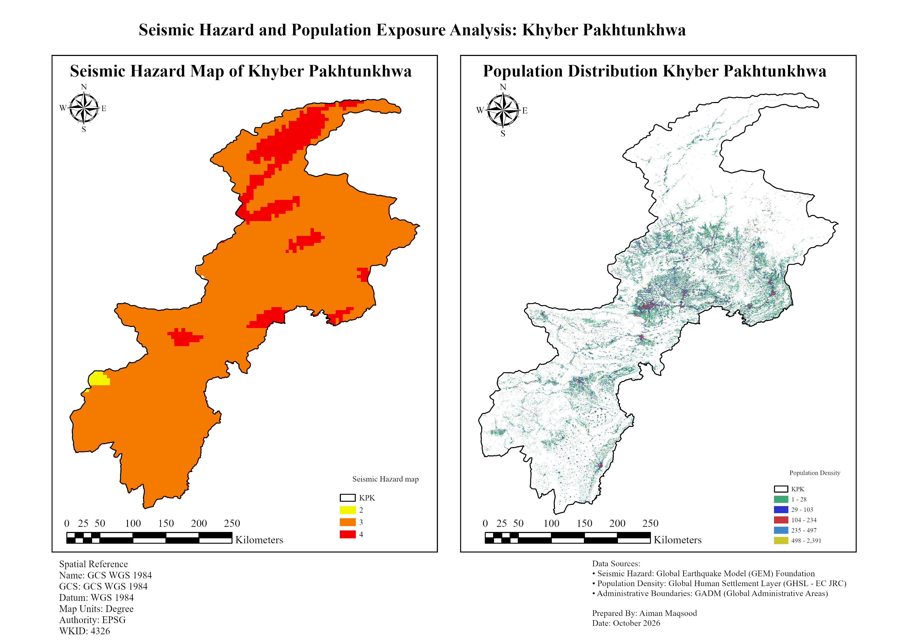

# Seismic Hazard and Population Exposure Mapping, Khyber Pakhtunkhwa (KPK), Pakistan

## Overview
Dual-panel map comparing probabilistic seismic hazard zones with population distribution across Khyber Pakhtunkhwa, to highlight where high hazard and high population overlap, particularly in northern KPK near active faults.

## Data
- Seismic hazard: Global Earthquake Model (GEM) Foundation probabilistic hazard data
- Population: GHSL GHS-POP, release R2023A, year 2020 (`JRC/GHSL/P2023A/GHS_POP/2020`), band `population_count` (people per cell), 100 m resolution. European Commission, Joint Research Centre.
- KPK boundary 
- Active faults

## Method
1. In Google Earth Engine, loaded the 2020 GHS-POP population count image.
2. Masked cells with values of zero or below, and clipped the image to the KPK boundary.
3. Exported the population raster at 100 m (EPSG:4326) to Google Drive.
4. In ArcGIS Pro, classified the GEM hazard data into hazard zones 
5. Compared hazard zones with population
6. Identified high-exposure areas
7. Designed a two-panel layout (hazard | population) with sequential color ramps, GCS WGS 1984 metadata and data attribution.

## Key findings
- ## Key findings
- Most of KPK falls in hazard class 3. The highest class (4) forms an elongated northeast-southwest band in northern KPK, with smaller isolated patches in the central and southeastern parts of the province. Class 2 appears only in a small area in the southwest.
- Population is concentrated in the central and eastern parts of the province, with the densest cluster around the Peshawar basin [confirm with district names]. The mountainous north has very few populated cells.
- The class 4 zone in northern KPK overlaps sparsely populated terrain, so total exposure there is low in absolute terms. The more populated areas mostly lie in class 3.
- [Quantify: population in each hazard class, e.g. "X million people (Y%) live in class 3 and Z people in class 4"]

## Tools
Google Earth Engine (JavaScript), ArcGIS Pro

## Links
- [GEE code (population data)](https://code.earthengine.google.com/f7e247aa912a822654395b1b24de1aec)
- [Download project package (opens in ArcGIS Pro)] https://drive.google.com/file/d/1g4gWULDU798xdlMkYYhpQoeOsjemAaaE/view?usp=sharing
  ## Limitations
- Hazard data is a global model, so local site effects such as soil amplification are not included.
- Population is a modeled estimate (GHS-POP), not a census count.
- Population counts were exported in a geographic coordinate system, so cell sums may differ slightly from the native grid.

## Data credits
Seismic hazard: GEM Foundation. Population: GHS-POP R2023A, European Commission Joint Research Centre. Copy the exact citation from the GEE Data Catalog page for this dataset.
